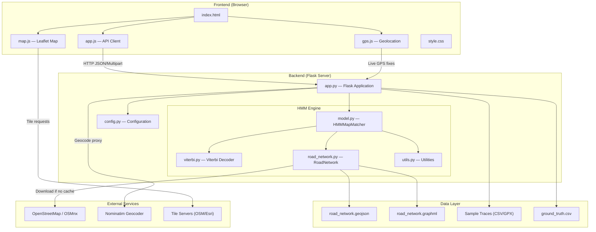
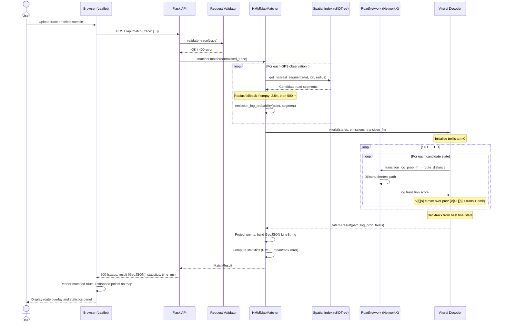
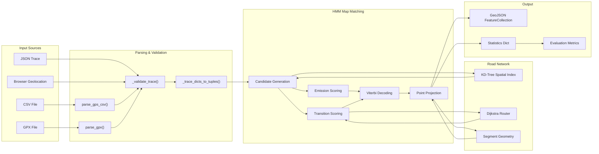
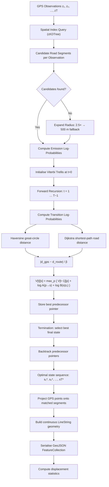
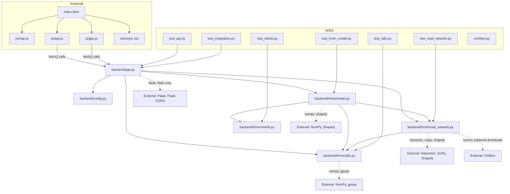

# System Architecture

> GPS Road Matching with HMM and Viterbi Decoding

---

## 1. Architecture Overview

The GPS Map Matching system follows a **three-tier architecture** comprising a browser-based frontend, a Flask REST API backend, and an HMM map-matching engine operating over a cached OpenStreetMap road network. The design prioritises separation of concerns: the frontend handles user interaction and visualisation; the API layer manages request validation, file parsing, and response formatting; and the core engine encapsulates all probabilistic inference logic.

| Layer | Responsibility | Key Technologies |
|---|---|---|
| **Presentation** | Interactive map, GPS input, trace upload, result display | Leaflet.js, HTML5 Geolocation API |
| **API** | REST endpoints, request validation, file parsing, error handling | Flask, Flask-CORS |
| **Engine** | HMM formulation, Viterbi decoding, candidate generation, scoring | NumPy, SciPy (cKDTree), NetworkX |
| **Data** | Road network graph, spatial index, GeoJSON cache | OSMnx, NetworkX GraphML, GeoJSON |

---

## 2. Component Diagram



---

## 3. Request–Response Sequence: `/api/match`



---

## 4. Data Flow Diagram



---

## 5. HMM Decoding Pipeline



---

## 6. Module Dependency Diagram



---

## 7. Technology Stack

| Category | Technology | Version / Notes |
|---|---|---|
| **Language** | Python 3.10+ | Type-annotated throughout |
| **Web Framework** | Flask | Lightweight WSGI framework |
| **CORS** | Flask-CORS | Cross-origin support for frontend |
| **Graph Library** | NetworkX | Road network graph + Dijkstra routing |
| **Spatial Index** | SciPy `cKDTree` | Fast nearest-neighbour queries on sampled road points |
| **Geometry** | Shapely | LineString operations, point projection |
| **Numerical** | NumPy | Log-space arithmetic, statistics |
| **OSM Download** | OSMnx | Optional; downloads road networks from OpenStreetMap |
| **GPX Parsing** | gpxpy | Optional; parses GPX track files |
| **Frontend Map** | Leaflet.js 1.9+ | Interactive map with tile layers and GeoJSON overlays |
| **Tile Providers** | OpenStreetMap, Esri | Street and topographic basemaps |
| **Place Search** | Nominatim | Geocoding API (proxied + rate-limited through Flask) |
| **Serialisation** | GeoJSON, GraphML | Road network persistence formats |
| **Testing** | pytest | Unit, integration, and API tests |
| **Configuration** | Environment variables | Via `Config` class with sensible defaults |

---

## 8. Key Design Decisions

### 8.1 Log-Space Computation

All probabilities are stored and accumulated as **log-probabilities**. This prevents floating-point underflow that would otherwise occur when multiplying many small probabilities across a long GPS trace. The Viterbi recurrence operates entirely in log space: addition replaces multiplication, and `max` replaces summation.

### 8.2 Gaussian Emission + Exponential Transition

The emission model uses a **1-D Gaussian** over the perpendicular distance from the GPS point to the road segment. The transition model uses an **exponential distribution** over the absolute difference between the great-circle GPS displacement and the shortest-path road distance. This formulation follows the approach of **Newson & Krumm (2009)**, which has become the standard probabilistic map-matching baseline.

### 8.3 Candidate Radius Fallback Strategy

Candidate generation uses a three-tier fallback to avoid empty candidate sets:

1. **Primary radius** (default 50 m) — cKDTree ball query
2. **Expanded radius** (2.5× = 125 m) — if no candidates found
3. **Emergency radius** (500 m, top 3 nearest) — last resort

This ensures the Viterbi trellis always has at least one state per time step, preventing path breaks.

### 8.4 Dijkstra Routing with Caching

Transition probabilities require the shortest-path road distance between candidate segments. This is computed via **Dijkstra's algorithm** on the NetworkX `MultiDiGraph`. Results are cached in a dictionary (bounded at 20,000 entries) to avoid redundant computations when the same segment pair appears at multiple time steps.

### 8.5 Undirected Fallback for Disconnected Graphs

If the directed shortest path between two segments is infinite (unreachable), the system falls back to an **undirected graph** search with a distance penalty (+50 m). This handles situations where one-way street topology would otherwise prevent valid transitions.

### 8.6 Spatial Indexing via Sampled Points

Rather than indexing road segment bounding boxes, the system **samples points along each segment** at 20 m intervals and builds a cKDTree over all sampled points. This provides accurate nearest-segment queries even for long, curved road geometries that a bounding-box approach would over-approximate.

### 8.7 Stateless API with Server-Side Graph

The Flask API is **stateless** with respect to client sessions. The road network graph is loaded once at startup (from cache or OSMnx download) and shared across all requests. Live GPS matching uses a client-managed point buffer with a server-side sliding window of 50 points, avoiding server-side session state.

### 8.8 GeoJSON as the Universal Exchange Format

All spatial data — road networks, matched routes, snapped points — is exchanged as **GeoJSON** between backend and frontend. This provides native compatibility with Leaflet's `L.geoJSON` layer and standard geospatial tooling.

---

## 9. API Endpoint Summary

| Method | Endpoint | Description |
|---|---|---|
| `GET` | `/api/health` | Service health and road network status |
| `POST` | `/api/match` | Match a JSON GPS trace |
| `POST` | `/api/upload` | Upload and match a CSV or GPX file |
| `POST` | `/api/match-live` | Incremental live GPS matching (sliding window) |
| `GET` | `/api/sample-data` | List available sample trace names |
| `GET` | `/api/sample-data/<name>` | Load a specific sample trace |
| `GET` | `/api/road-network` | Retrieve current road network as GeoJSON |
| `POST` | `/api/road-network/load` | Load OSM roads for a map viewport (bbox) |
| `GET` | `/api/geocode?q=...` | Place search via Nominatim proxy |
| `GET` | `/api/metrics` | Evaluation metrics against ground truth |

---

## 10. Directory Structure

```
GPS Road Matching Project/
├── backend/
│   ├── app.py              # Flask application factory and API routes
│   ├── config.py           # Centralised configuration (env overrides)
│   ├── __init__.py
│   ├── cache/              # Cached road network files
│   │   ├── road_network.geojson
│   │   └── road_network.graphml
│   └── hmm/
│       ├── __init__.py
│       ├── model.py        # HMMMapMatcher, MatchResult
│       ├── viterbi.py      # Viterbi decoder (log-space DP)
│       ├── road_network.py # RoadNetwork, RoadSegment, spatial index
│       └── utils.py        # Haversine, projections, CSV/GPX parsing, metrics
├── frontend/
│   ├── index.html          # Main web page
│   ├── css/style.css       # Application styles
│   └── js/
│       ├── app.js          # API client and UI logic
│       ├── map.js          # Leaflet map initialisation and layers
│       └── gps.js          # Browser Geolocation API wrapper
├── data/
│   ├── sample_trace_delhi.csv
│   ├── sample_trace_clean.csv
│   ├── sample_trace_noisy.csv
│   ├── sample_trace_sparse.csv
│   ├── sample_gpx_trace.gpx
│   └── ground_truth.csv
├── presentation/
│   └── SLIDES.md
├── docs/
│   ├── ARCHITECTURE.md     # (this file)
│   └── PROJECT_REPORT.md
├── scripts/
│   └── generate_test_data.py
├── tests/
│   ├── conftest.py
│   ├── test_viterbi.py
│   ├── test_hmm_model.py
│   ├── test_road_network.py
│   ├── test_utils.py
│   ├── test_api.py
│   └── test_integration.py
├── pyproject.toml
├── run.ps1
└── README.md
```
